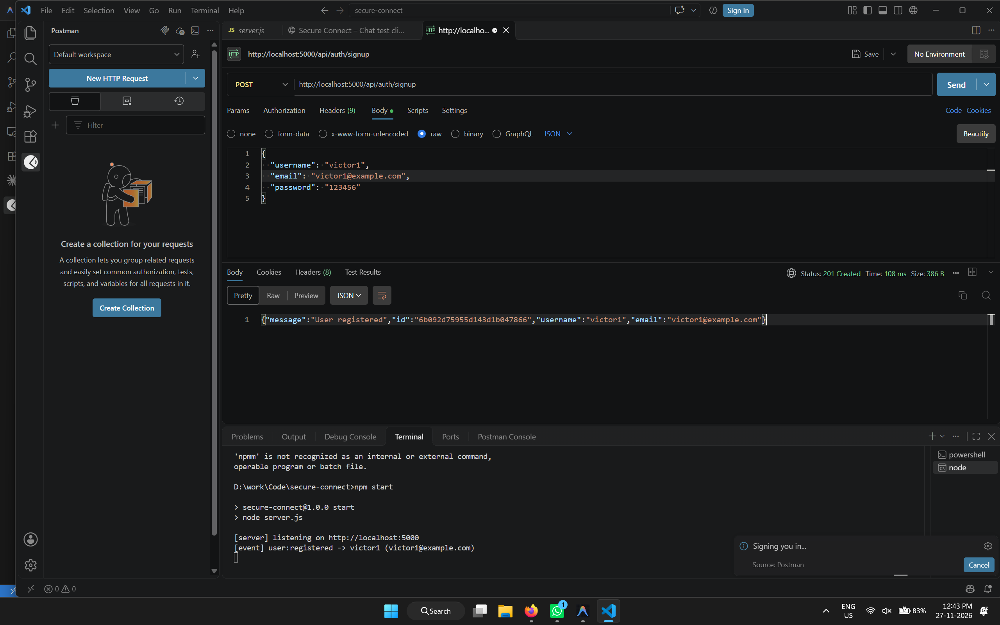
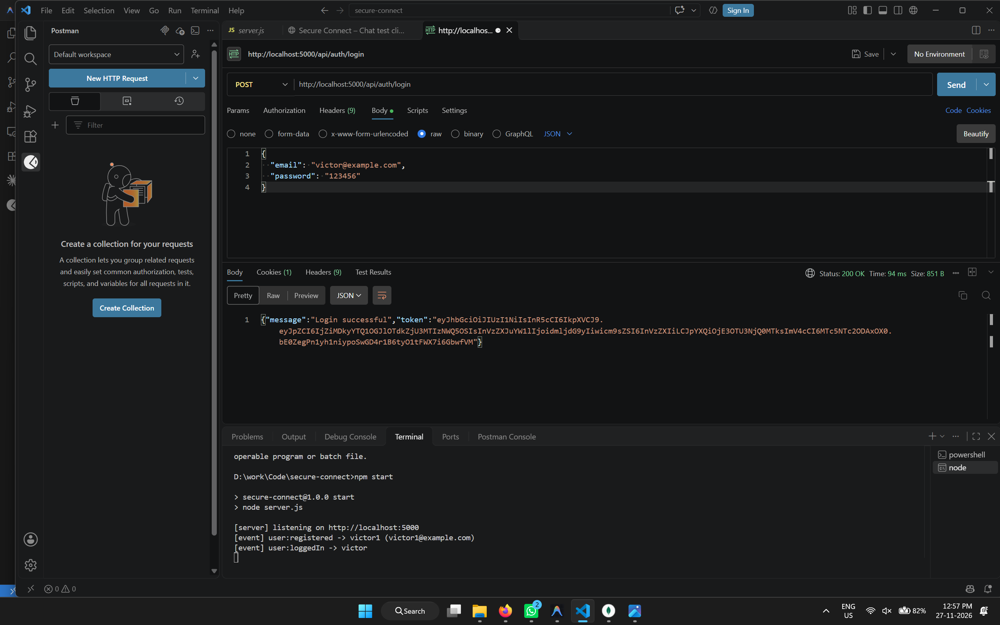
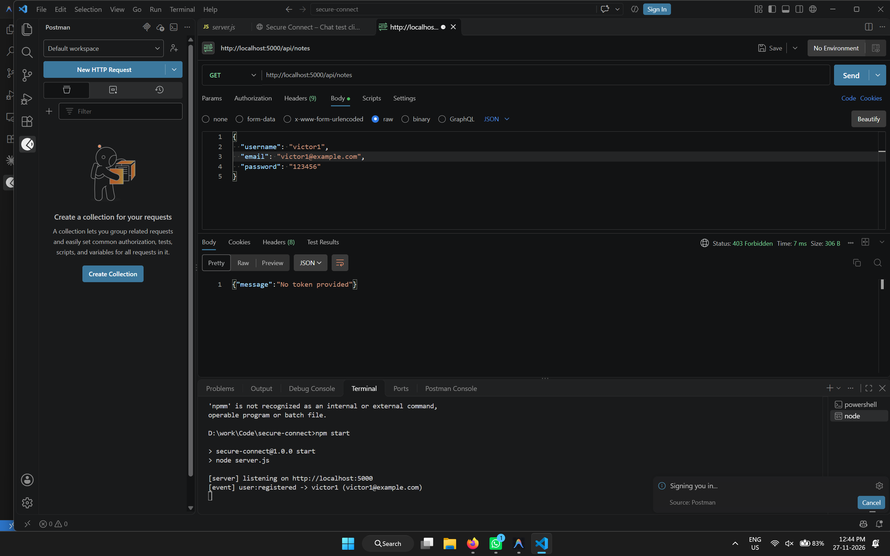
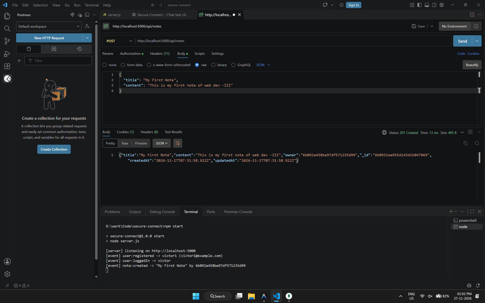
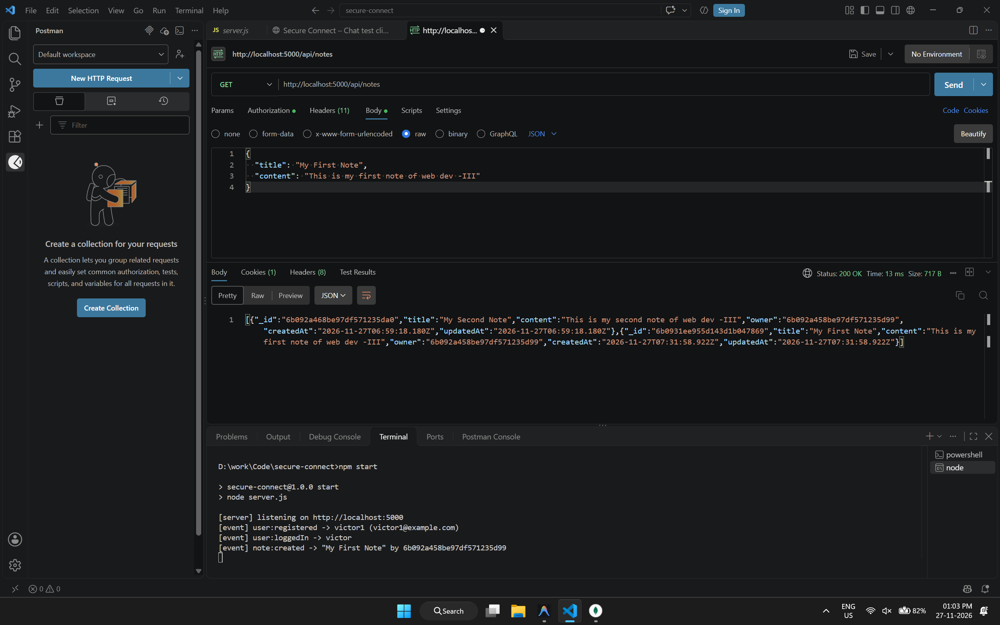
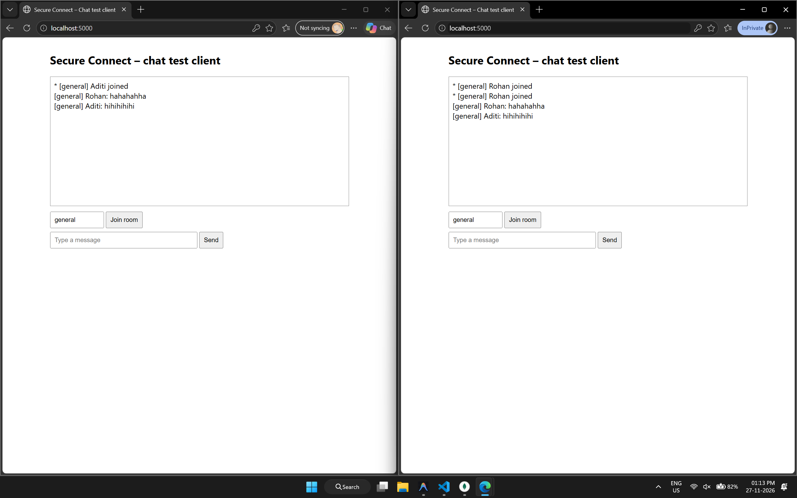

# Lab 4 – Secure Connect and Communication Platform

**Course:** Web Dev III  
**Unit Covered:** Unit – 4  
**Tech Stack:** Node.js, Express.js, JWT (`jsonwebtoken`), `bcrypt`, `dotenv`, Socket.IO, MongoDB (`mongoose`).

---

## Overview

A secure server-side application providing user registration, JWT-based authentication, protected personal notes CRUD operations, role-based access control (RBAC), event-driven metrics via Node.js `EventEmitter`, and real-time bidirectional chat communication using Socket.IO without pre-built authentication frameworks.

---

## Quick Start

1. **Install dependencies:**
   ```bash
   npm install
   ```

2. **Configure environment:**
   Create a `.env` file (or copy `.env.example`):
   ```env
   PORT=5000
   MONGO_URI=mongodb://127.0.0.1:27017/secure_connect
   JWT_SECRET=your_long_random_jwt_secret_key
   JWT_EXPIRES_IN=1h
   ADMIN_EMAILS=admin@example.com
   NODE_ENV=development
   ```

3. **Start MongoDB and the Server:**
   ```bash
   npm start
   ```
   Server runs on `http://localhost:5000`.

---

## API Documentation

### Authentication & Authorization
| Method | Endpoint | Auth Required | Description |
|---|---|---|---|
| `POST` | `/api/auth/signup` | No | Register new user with username, email, and password (returns `201`) |
| `POST` | `/api/auth/login` | No | Authenticate user, receive JWT token and httpOnly `token` cookie (returns `200`) |
| `POST` | `/api/auth/logout` | No | Clears the `token` cookie |
| `GET` | `/api/auth/me` | JWT | Get current authenticated user profile |

### Notes API (Protected CRUD)
| Method | Endpoint | Auth Required | Description |
|---|---|---|---|
| `POST` | `/api/notes` | JWT | Create a new note (sets `owner` to authenticated user) |
| `GET` | `/api/notes` | JWT | List all notes owned by the authenticated user |
| `GET` | `/api/notes/:id` | JWT | Get a specific note by ID (owner only) |
| `PUT` | `/api/notes/:id` | JWT | Update note title and content (owner only) |
| `DELETE` | `/api/notes/:id` | JWT | Delete a note (owner only) |

### Admin & RBAC
| Method | Endpoint | Auth Required | Description |
|---|---|---|---|
| `GET` | `/api/admin/users` | JWT + Admin | List all registered users |
| `DELETE` | `/api/admin/users/:id` | JWT + Admin | Delete user and their associated notes |
| `GET` | `/api/admin/stats` | JWT + Admin | View event counters collected via `EventEmitter` |

---

## Real-Time Chat (Socket.IO)

- Real-time room-based communication authenticated via JWT handshake (`auth.token` or cookie).
- Connect with `io({ auth: { token } })`.
- Events:
  - Client emits: `joinRoom`, `leaveRoom`, `chatMessage { room, text }`
  - Server emits: `message`, `history`, `system`, `error_message`
- A lightweight browser test client is available directly at `http://localhost:5000`.

---

## Output Screenshots

### Fig 1. Signup and Login Responses
#### User Registration (`POST /api/auth/signup` → Status `201 Created`):


#### User Login (`POST /api/auth/login` → Status `200 OK` with JWT Token):


---

### Fig 2. Notes API — Token Protection & CRUD
#### Blocked Without Token (`GET /api/notes` → Status `403 Forbidden`):


#### Create Note with JWT (`POST /api/notes` → Status `201 Created`):


#### List Notes with JWT (`GET /api/notes` → Status `200 OK`):


---

### Fig 3. Real-Time Chat Activity via Socket.IO
#### Multi-Client Bidirectional Chat Client:

